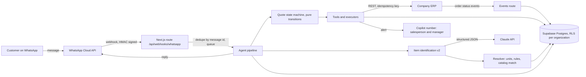

# WhatsApp AI Sales Agent

[](https://github.com/leonardo-merlo/whatsapp-ai-sales-agent/actions/workflows/ci.yml)

An AI assistant that works inside a salesperson's WhatsApp: it identifies the customer, turns free-text, photo and audio orders into catalog items, checks delivery and payment, and prepares the quote in the company's ERP. In production at a B2B steel distributor in Brazil.

> **About this repository.** Developed over 4 months (July to November 2026) in a private production repository (480+ commits). This is a sanitized snapshot: client data and client-specific business rules were replaced with fictional ones (a made-up company, **Distribuidora Exemplo**). Code and comments are in Portuguese; see the [glossary](#glossary-pt--en).

## The problem

B2B customers order on WhatsApp the way they talk at the counter: "50 varas de 3/8 e 8 kg de prego 17x21", a photo of a handwritten list, a voice note. A salesperson spends most of the day translating that into catalog codes, checking the customer record, delivery region and payment terms, and typing the quote into the ERP.

## What it does

Implemented:

- **Runs on the salesperson's own number** (WhatsApp Cloud API coexistence): the AI is an identified assistant of the salesperson, and a separate "copilot" number sends alerts to the salesperson and the manager.
- **Customer identification** by CPF/CNPJ against the ERP, and registration of new customers with the fields the ERP requires.
- **Product identification**: the model only reads and labels each line (family, measures, quantity, qualifiers) as structured JSON; the code normalizes units (inch to mm, sheet gauge), applies the company's rules and resolves against the catalog. Ambiguous items become a question with options, never a guess.
- **Photo, audio and PDF orders**: transcribed before identification.
- **Quote flow as a state machine**: document, customer record, delivery city, item list, payment method. Several open quotes per conversation.
- **ERP integration**: customer lookup and creation, price quote, quote creation (idempotent), daily product and region syncs, order status events pushed by the ERP.
- **Admin panel** (Next.js): conversations with human takeover, contacts, agent configuration, catalog, WhatsApp templates, ERP settings.
- **Multi-tenant**: several companies, each with its own numbers, catalog and ERP credentials.

Behind a flag, not enabled in production yet: going from the confirmed item list straight to the ERP price quote and quote creation inside the v2 pipeline (`V2_ORCAMENTO`).

Planned: per-product delivery regions, conversion metrics on the panel.

## Architecture



## Tech stack

- **Next.js 16** (App Router), **React 19**, **TypeScript** (strict), **Tailwind CSS 4**
- **Supabase**: Postgres with row-level security, Auth, Vault for per-company credentials
- **Anthropic SDK** (Claude): structured outputs, tool use, prompt caching
- **WhatsApp Cloud API** (Meta Graph API), Embedded Signup
- Node's built-in test runner (`node:test`), ESLint 9
- Also integrated: Asaas (billing), Resend (email), Whisper-compatible transcription (Groq or OpenAI), Vercel Cron

## Key technical decisions

1. **The model reads, the code decides.** In the v2 pipeline the model only extracts what the customer wrote; unit conversion, business rules and the catalog match are deterministic code (`app/src/lib/v2/`). Prices, totals and item lists sent to the customer are composed by code from the ERP response (`app/src/lib/erp/mensagem-do-orcamento.ts`), never written by the model.
2. **A state machine for the quote.** Transitions are pure functions (`app/src/lib/agente/maquina/transicoes.ts`); the I/O (database, ERP, model) lives in `conduzir.ts`, which feeds events back into the machine. Guards read only the quote state, not the chat history.
3. **Multi-tenant from day one.** Tenant data carries `organization_id`, with RLS policies in the migrations; the active-organization cookie selects but never authorizes (`app/src/lib/data/org-ativa.ts`). ERP credentials and per-number WhatsApp tokens live in Supabase Vault.
4. **Built for retries.** Meta re-delivers webhooks when a response is slow, so sales numbers always go through a queue (`app/src/lib/agente/fila.ts`), messages are deduplicated by WhatsApp message id, and quote creation is idempotent on this side too (`app/src/lib/erp/idempotencia.ts`), not only through the ERP's idempotency key.
5. **Measured cost, and test doubles that behave like production.** Every model call records tokens and cost at the price of the day (`ai_usage`, `app/src/lib/agente/precos-ia.ts`). The fake Supabase client used in tests rejects what Postgres rejects (for example `ON CONFLICT` on a partial unique index), and the ERP simulator is the same code the tests and the local demo use (`app/src/lib/erp/simulador.ts`).

## Testing

```bash
cd app
npm test          # node:test, ~990 tests, no network and no paid API calls
npm run lint
npx tsc --noEmit
```

- Tests live in `app/test/`, one file per behavior; doubles and fixtures in `app/test/apoio/` (fake Supabase client, fake HTTP for Anthropic and WhatsApp, the fictional catalog).
- End-to-end flows go through the real webhook route with doubled external services: `vendas-ponta-a-ponta.test.ts`, `v2-ponta-a-ponta.test.ts`.
- Schema and RLS suites run against a real Postgres when `SUPABASE_DB_URL` is set, and skip themselves otherwise (as in CI).

## Getting started

Requirements: Node 22; for the local demo, the Supabase CLI and Docker.

```bash
cd app
npm ci
npm test                      # works without any service
cp .env.example .env.local    # every variable is documented there
```

Local demo with the fictional company. These steps were not run end to end for this snapshot; the test suite does not depend on them.

```bash
supabase init && supabase start          # from the repository root
supabase db reset                        # applies supabase/migrations
psql "$SUPABASE_DB_URL" -f supabase/seeds/001_distribuidora_exemplo.sql
node --experimental-strip-types app/scripts/simulador-erp.mjs   # fictional ERP on port 4000
cd app && npm run dev
```

Then sign up in the app, add your user to the demo organization (`e8e00000-0000-4000-8000-0000000000e1`) in `organization_members`, and save the fictional ERP key (`chave-de-homologacao`) under Desenvolvimento > ERP. Talking to the agent needs an Anthropic API key; the WhatsApp side needs a Meta app.

## Glossary (PT → EN)

| Code (PT) | English |
|---|---|
| orçamento | quote |
| pedido | order |
| cotação, cotar | price quote, to quote |
| cliente, cadastro | customer, customer record |
| vendedor, gestor | salesperson, manager |
| copiloto | copilot number (alerts only) |
| catálogo, grupo, família | catalog, ERP product group, product family |
| molde | description parser for one product group |
| medida, bitola, chapa | measure, gauge or diameter, sheet gauge |
| gíria | counter slang |
| resolvedor | resolver (catalog match) |
| máquina de estados, transição | state machine, transition |
| trava | guard |
| roteiro (vendas, atendimento) | playbook (sales, customer service) |
| ferramenta | tool (model tool use) |
| simulador | ERP simulator (fake ERP) |
| dublê | test double |
| região de entrega | delivery region |
| forma, condição de pagamento | payment method, payment terms |
